# cafe&BAR Caprice 写真撮影リスト（コンセプト案3用）

コンセプト案3のサイトに載っている「AIで作った仮の写真」を、実際のお店の写真に差し替えるための撮影リストです。**どこに・何を・どう撮るか**を6枚ぶんまとめました。スマホで開いても読めます。

PDF版（印刷・共有用）: [photo-shotlist.pdf](photo-shotlist.pdf)

## 撮影の前に（共通のポイント）

- 昼間の自然光で撮る。窓は**左の壁に3枚・下の壁に1枚**なので、左・下の窓の近くが一番きれいです。電気は消さず、暖かい色のライトならそのままでOK
- 窓に向かって撮らない（逆光で被写体が暗くなります）。窓の光は**横から**、または**カメラの後ろから**当てるのが基本です
- 直射日光が差し込む時間は避ける（光が強すぎて白く飛びます）。やわらかい光（薄曇り・日陰側の時間）が理想で、レースのカーテンがあれば閉めると整います。**窓がどの方角を向いているか、いつ日が差すか**を、撮影前に1度確認してください
- ホワイトバランスはやや暖かめに。ドアからの光が入ると青っぽくなりやすいので、見た目より青いと感じたら撮り直す
- 資材・段ボール・コード・テレビ・リモコンは写さない（撮る前に1回どかす）
- 上下左右に余裕を持たせて撮る。サイトの画面によって端が切れます
- 人が写る場合は、顔が分からない角度にするか、本人の了承を得る
- 縦向きでなく**横向き**で撮る
- 内装が完成していない部分は写さなくて大丈夫です

**優先順位：①ヒーロー（hero.jpg）と ②お店のこと（room.jpg）を最優先**。残りの4枚はその次で構いません。

## お店の間取りと撮る位置

オーナーさんの手描きの間取りをもとに、6枚それぞれを**どこに立って、どちらに向けて撮るか**を決めました。赤い丸の番号が写真の番号、扇形がカメラの向きです。黄色い矢印は窓から入る自然光の向きです。

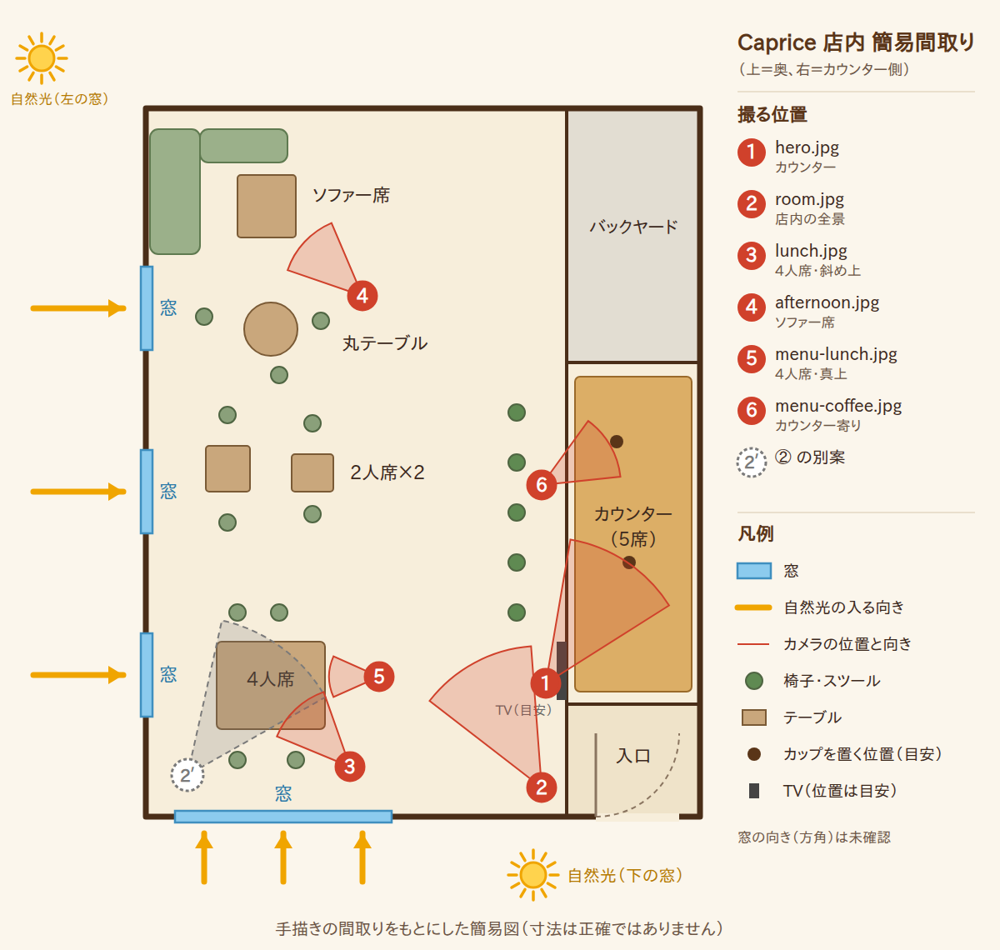

| 番号 | 写真 | 立つ場所 | 向き | 光の向き |
|---|---|---|---|---|
| ① | hero | カウンター手前のスツール側（腰を落とす） | 奥へ、カウンターに沿って右上へ | 左の窓から横光 |
| ② | room | 入口側の角（別案：左下の角） | ソファー席（左奥）へ斜め（別案：右奥のカウンター側） | 左の窓は横、下の窓は背中側 |
| ③ | lunch | 4人席の右下（下の窓の前） | 4人席を斜め45°上から、左上へ | 左の窓の横光＋下の窓のやわらかい光 |
| ④ | afternoon | ソファー席の四角いテーブルの右手前 | ソファー側（左奥）へ | 左の窓から横光 |
| ⑤ | menu-lunch | 4人席の右側（窓と反対側） | 天板へ真上から | 左から。影は右へ |
| ⑥ | menu-coffee | カウンターのスツール側（中ほど） | カップへ斜め45°上から（右奥へ） | 左うしろ〜左から |

**避けるもの**：テレビ（図の位置は目安）、バックヤードの扉、入口まわり（①②では写り込みやすいので、立ち位置とトリミングで外します）。

---

## 全体マップ

ピンクの枠と番号が、写真を入れ替える場所です（スマホ表示）。

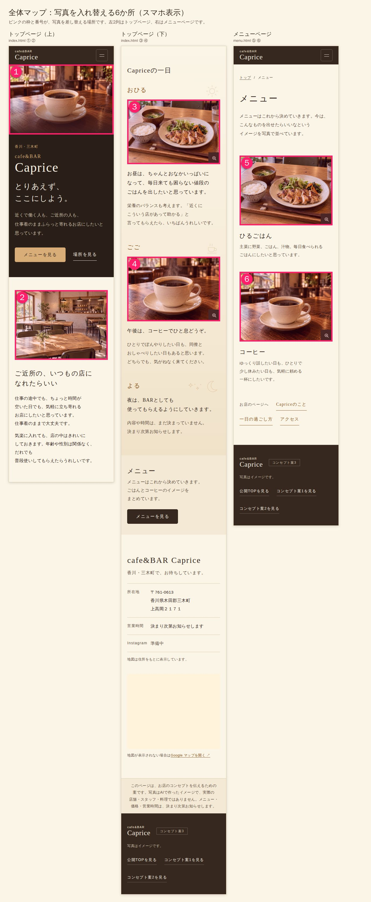

---

## 1. ヒーロー（トップページの一番上・右側）　`hero.jpg` ★最優先

| 項目 | 内容 |
|---|---|
| ファイル名 | `hero.jpg` |
| 比率・サイズ | 3:2（横長）・2000×1333 以上 |
| 使う場所 | トップページ最上部、右側の大きな写真 |

**狙い**：低い位置から、右上へ流れる琥珀色の長いカウンターと、湯気の立つ1杯。奥の丸いペンダントと棚下の暖色ライトを、ぼけた光にする

**撮る位置**：間取り図の①（カウンターの入口寄りのスツール側に、カウンターの高さまで腰を落として立ち、バックヤード側＝奥へ、カウンターに沿って右上へ向けて）

**撮るもの**
- 琥珀色のカウンターに置いたコーヒー1杯。カウンターの手前〜中ほどに置く
- カウンターの線が、画面の左下から右上へ斜めに奥へ伸びる
- 奥は胡桃色の板壁・丸いペンダント・棚下のあたたかい光が、ぼけた背景になる
- 湯気が立っていれば最高です（入れたてをすぐ撮る）

**構図のコツ**
- PCでは写真が「ほぼ正方形」に表示され、左右が約11%ずつ切れます。スマホでは横長の帯（3:2に近い）、タブレットでは細長い帯になり上下が約10%切れます
- カップは「中央より少し右」、高さは真ん中か少し上。カウンターの線をカップの下に通す
- カメラはカウンターの高さまで下げ、絞りを開けて（スマホはポートレートモードでも可）奥をぼかす
- 光は左の窓から横に当たります。左1/3はサイトの文字の影で暗くなり、スマホでは下も暗くなるので、大事なものは置かない（ここは板壁やカウンターのぼけでOK）
- 四方に余白を残して撮る（後で私が切り出します）

**NG例**
- カップが画面いっぱいで、縁や取っ手が切れている
- 背景にテレビ・バックヤードの扉・段ボール・コードが写っている（奥の扉は、カウンターの上に低く構えて画面外に）
- 窓に向けて撮って、カップが暗いシルエットになっている
- ドアの光で全体が青白い

**ページ上の位置**（ピンクの枠が差し替える写真）

| パソコン | スマホ |
|---|---|
| 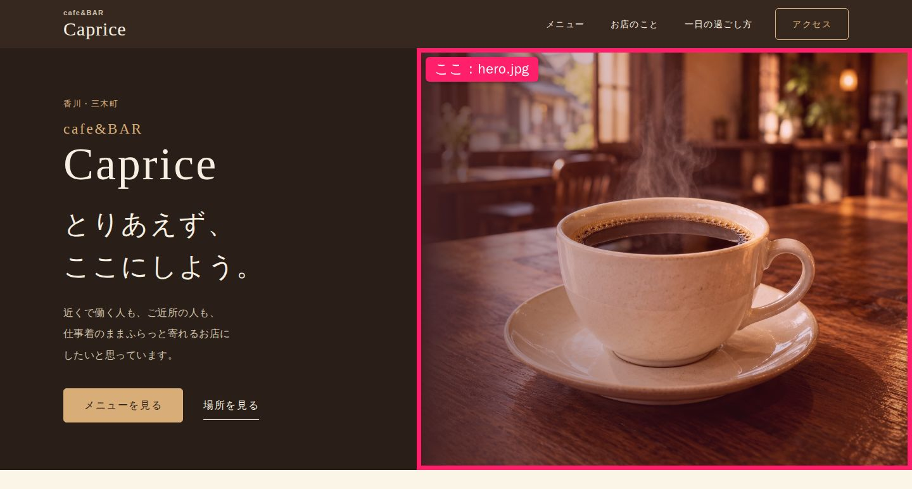 | 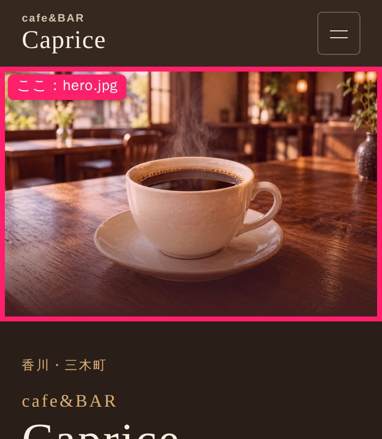 |

**構図ガイド**

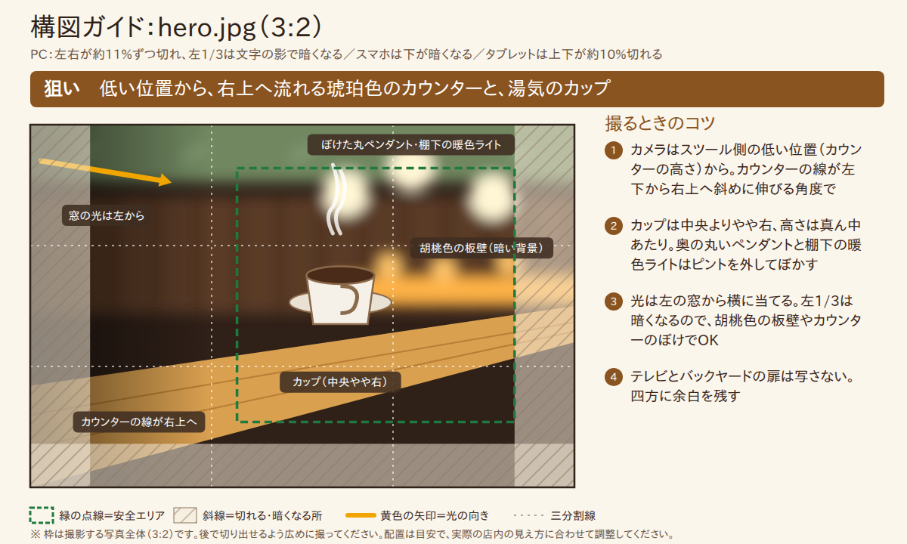

**仮の参考**

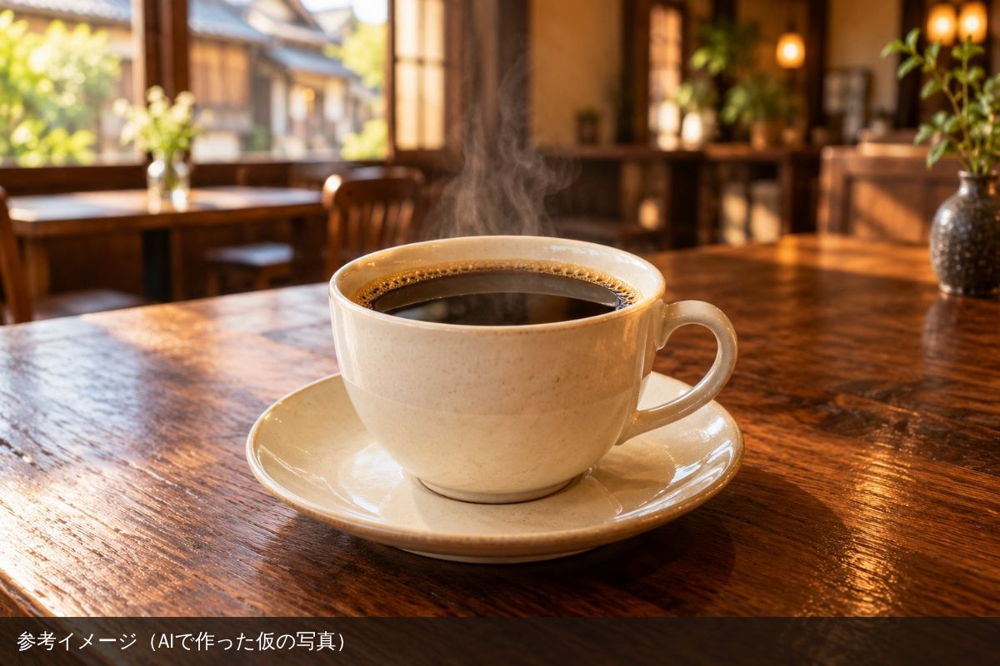

*仮の参考（構図は構図ガイドを優先）。AIで作った仮の写真で、実際のお店とは構図が少し異なります*

**参考画像の生成プロンプト（Codex CLIなど用）**

```text
Low-angle shot at counter height from the stool side: a single steaming white coffee cup on a long amber butcher-block cafe counter, placed slightly right of center at mid-height. The counter line recedes diagonally from the lower left to the upper right. Background heavily blurred with shallow depth of field: dark walnut vertical wood paneling, a sage-green leaf-patterned gabled ceiling, soft white globe pendant lights and warm amber under-cabinet glow as bokeh in the upper right. The left third of the frame falls into soft shadow. 3:2 landscape. Photorealistic, natural daylight from the left window, warm white balance, no people's faces, no text, no logos.
```

---

## 2. お店のこと（トップページ・ヒーローの下）　`room.jpg` ★最優先

| 項目 | 内容 |
|---|---|
| ファイル名 | `room.jpg` |
| 比率・サイズ | 4:3・1600×1200 以上 |
| 使う場所 | 「ご近所の、いつもの店に」の文章の隣（スマホは上）の写真 |

**狙い**：入口の角から斜めに。葉っぱ柄の切妻天井・丸いペンダント・左の窓の光が、1枚で「この店だ」と分かる

**撮る位置**：間取り図の②（入口側の角＝右下に立ち、ソファー席の角＝左奥へ斜めに向けて）。別案は②′（左下の角に立ち、右奥のカウンター側へ向けて）

**撮るもの**
- 店内を斜めに引いて撮った1枚：葉っぱ柄の切妻天井が上1/3、丸いペンダントがその下、テーブルと緑の椅子とヘリンボーンの床が下1/3
- 左の窓が光の入口として画面の左に入る。奥にソファー席
- 人は写さない（写るなら後ろ姿）

**構図のコツ**
- PC・スマホはほぼ全体が表示されます。タブレット幅だけ上下が約11%ずつ切れます
- 入口側の角から、ソファー席の角へ斜め（対角線）に撮ると、部屋が奥へ長く見えます。カメラは水平、目線より少し高く
- ペンダントライトは上1/3の線のあたり、テーブルと椅子は下1/3
- 天井は上に少し見えれば十分。ぎりぎりを狙わない
- 窓が真っ白に飛ぶ時は、窓の外が明るすぎない時間にするか、露出を少し下げる
- 別案②′（左下の角から右奥へ）は、カウンターと緑のスツールが見えるカットになります。②と②′のどちらが良いか、両方撮ってもOK

**NG例**
- 片付け前の資材・脚立・段ボールが写っている
- テレビ・バックヤードの扉・入口まわりが写っている
- 広角で端が大きくゆがんでいる（ゆがむ時は少し下がって撮る）
- 人の顔がはっきり写っている

**ページ上の位置**（ピンクの枠が差し替える写真）

| パソコン | スマホ |
|---|---|
| 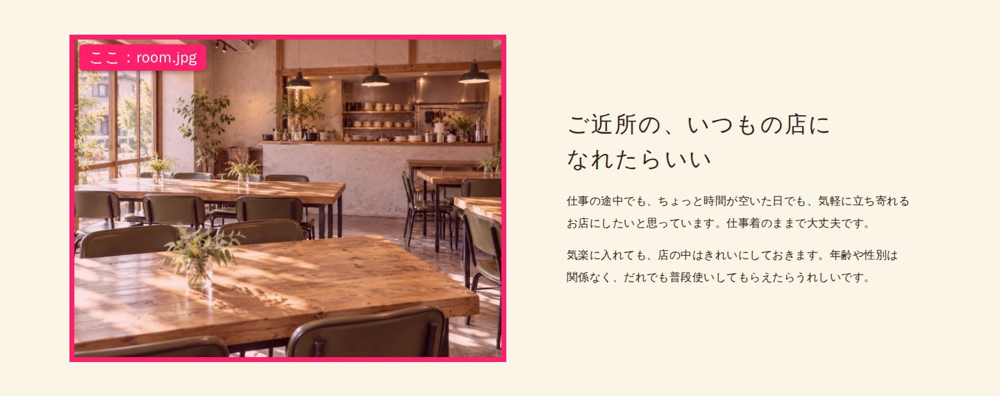 | 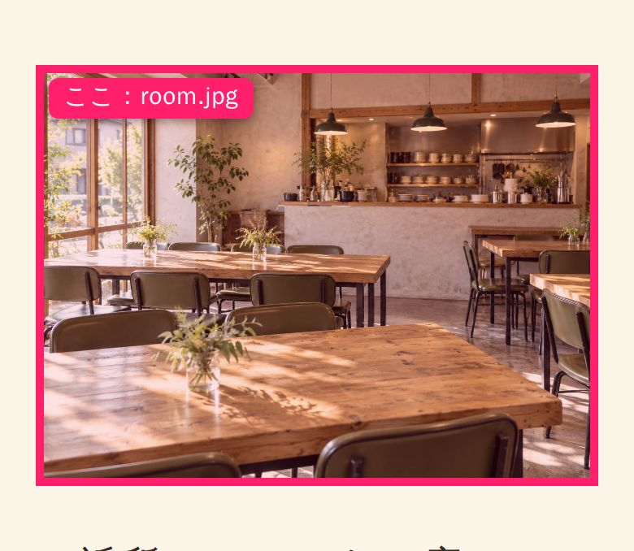 |

**構図ガイド**

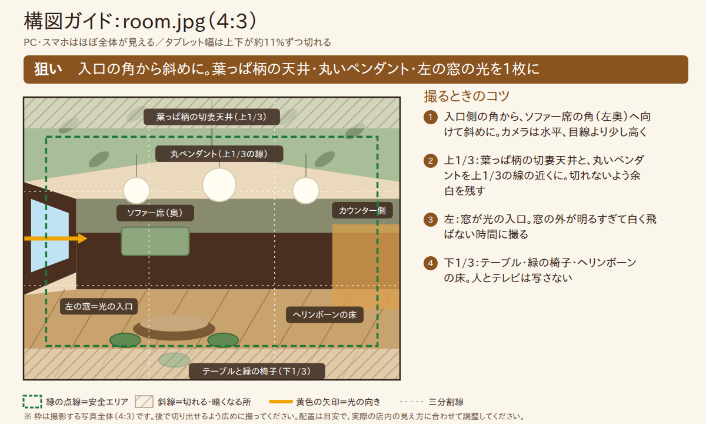

**仮の参考**

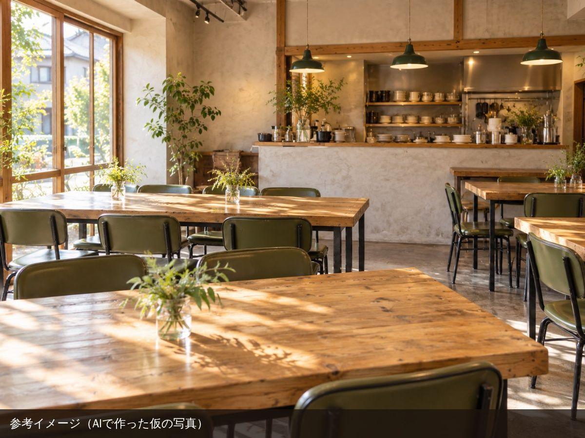

*仮の参考（構図は構図ガイドを優先）。AIで作った仮の写真で、実際のお店とは構図が少し異なります*

**参考画像の生成プロンプト（Codex CLIなど用）**

```text
Wide interior view of a small Japanese cafe shot diagonally from the entrance corner toward the sofa corner at the far left, camera level and slightly above eye height. Top third: a gabled ceiling covered in sage-green leaf wallpaper, with round white globe pendant lights hanging along the upper-third line. Left side: three windows letting in soft daylight. Dark walnut vertical wood paneling on the walls, green corduroy chairs and wooden tables on a herringbone wood floor in the lower third, a green sofa in the far corner. No people. 4:3 landscape. Photorealistic, natural daylight from the left window, warm white balance, no people's faces, no text, no logos.
```

---

## 3. 一日：おひる（トップページ「Capriceの一日」）　`lunch.jpg`

| 項目 | 内容 |
|---|---|
| ファイル名 | `lunch.jpg` |
| 比率・サイズ | 4:3・1600×1200 以上 |
| 使う場所 | 「おひる」の横の写真（タップで拡大表示もされます） |

**狙い**：窓の横光で、4人席のランチを斜め45°から。背景に暗い胡桃の板壁やヘリンボーンの床が入り、料理が明るく浮かぶ

**撮る位置**：間取り図の③（4人席の右下側＝下の窓の前に立ち、4人席を斜め45°上から、左上へ向けて）

**撮るもの**
- 出す予定のランチを4人席の木のテーブルに置き、斜め45°から
- 主菜・副菜・ごはん・汁物が全部入るように。主菜を手前、汁物を奥に
- 奥には胡桃色の板壁や床が暗く入る（料理を引き立てる背景）

**構図のコツ**
- PC・スマホはほぼ全体、タブレット幅は上下が約10%切れ、拡大表示では上下が約5%切れます
- 左の窓の光が横から当たる向きで撮る（窓を背にも正面にもしない）。光が強すぎる時は、レースのカーテンや白い紙で光をやわらげる
- お盆ごと、四方に少し余白を残す
- 料理の中心にピントを合わせる

**NG例**
- お皿が切れている・料理が端に寄っている
- 使い捨ての容器や、まだ決まっていない器で撮る
- 自分の影が料理に落ちている
- 窓に向かって撮って、料理が暗くなっている

**ページ上の位置**（ピンクの枠が差し替える写真）

| パソコン | スマホ |
|---|---|
| 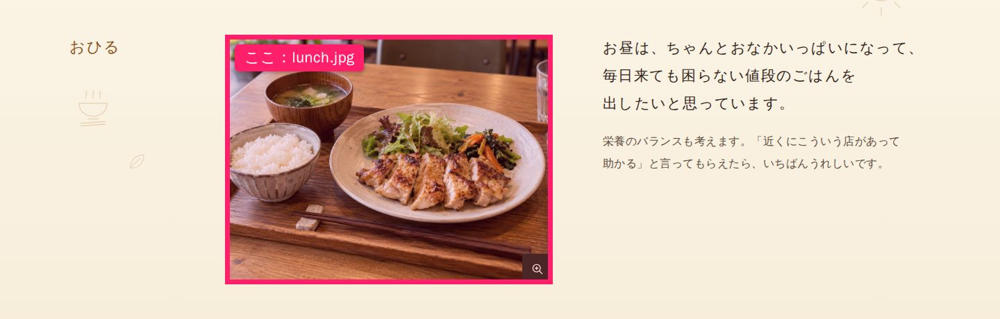 | 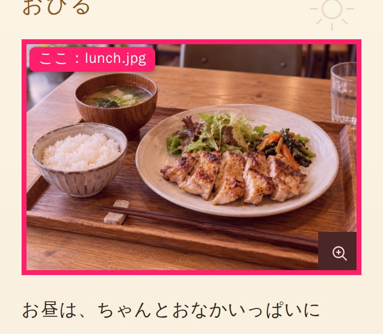 |

**構図ガイド**

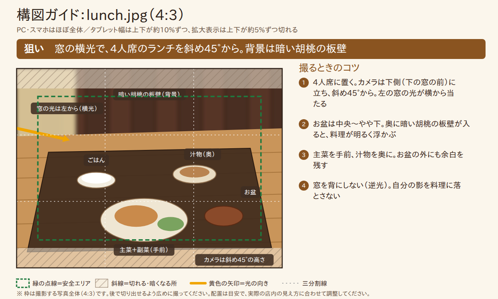

**仮の参考**

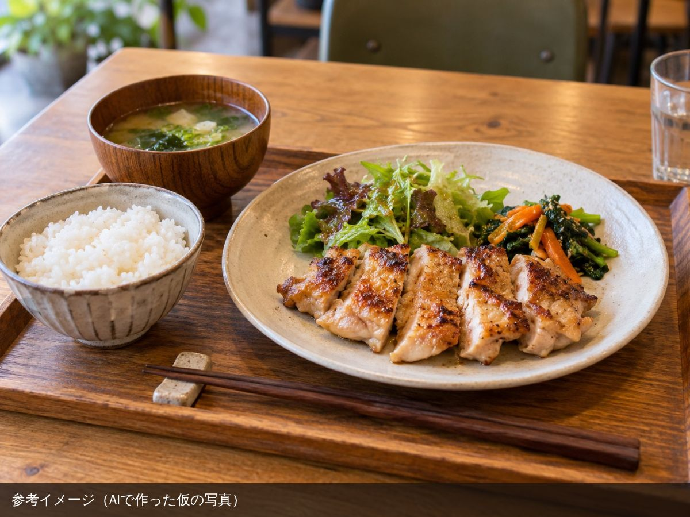

*仮の参考（構図は構図ガイドを優先）。AIで作った仮の写真で、実際のお店とは構図が少し異なります*

**参考画像の生成プロンプト（Codex CLIなど用）**

```text
A Japanese cafe lunch tray (main dish, side dishes, rice, miso soup) on a wooden four-seat table, shot from a 45-degree angle above. Soft side light from a window on the left. The background behind the table falls into dark walnut vertical wood paneling and a herringbone floor, so the food glows against it. The main dish is in the foreground and the soup bowl toward the back; space around the tray. 4:3 landscape. Photorealistic, natural daylight from the left window, warm white balance, no people's faces, no text, no logos.
```

---

## 4. 一日：ごご（トップページ「Capriceの一日」）　`afternoon.jpg`

| 項目 | 内容 |
|---|---|
| ファイル名 | `afternoon.jpg` |
| 比率・サイズ | 4:3・1600×1200 以上 |
| 使う場所 | 「ごご」の横の写真 |

**狙い**：ソファー席の角。手前にカップ、奥には窓の光と、ぼけた葉っぱ壁紙・ソファーの緑

**撮る位置**：間取り図の④（ソファー席の四角いテーブルの右手前の低めの位置に立ち、ソファー側＝左奥へ向けて）。別案は、左の窓際の丸テーブル

**撮るもの**
- ソファー席の小さな四角いテーブルに置いたコーヒー。ヒーローとは別カット
- 手前にカップ、奥にソファーの緑と葉っぱ柄の壁がやわらかくぼける
- 左の窓の光が画面の左から入る

**構図のコツ**
- この写真だけ、サイト側で約1.2倍に拡大して表示されるため、周りが少し切れます。カップは中央〜やや左下に置き、寄りすぎない
- 窓の光が横から入る向きで。奥が少し暗いと、湯気が光に透けてきれいに写ります
- カップの周りに木のテーブルの余白を多めに

**NG例**
- ヒーローと同じ構図・同じカップの角度
- 窓の外に工事現場や車が写っている
- 窓に向けて撮って、カップが暗くなる（逆光すぎ）

**ページ上の位置**（ピンクの枠が差し替える写真）

| パソコン | スマホ |
|---|---|
| 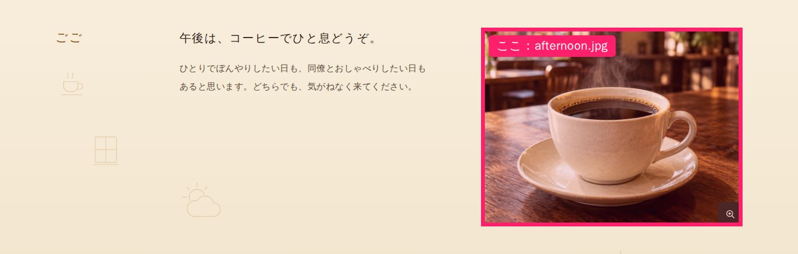 | 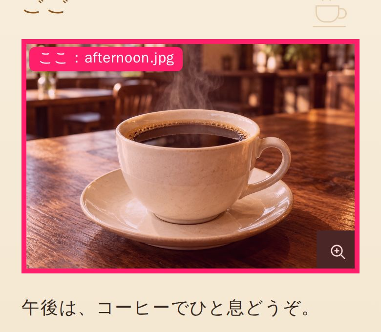 |

**構図ガイド**

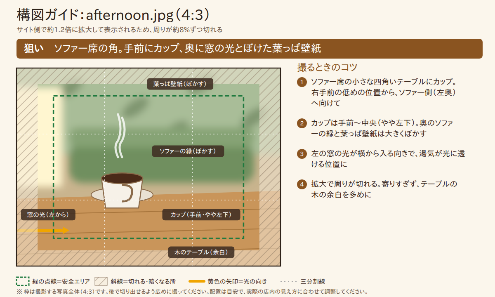

**仮の参考**

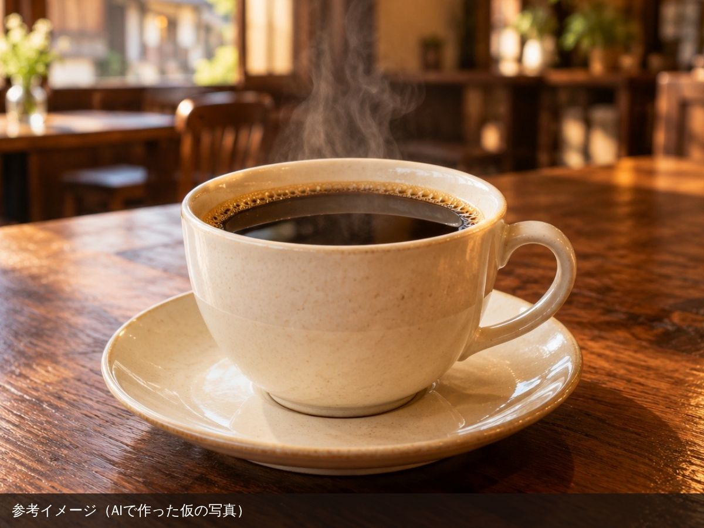

*仮の参考（構図は構図ガイドを優先）。AIで作った仮の写真で、実際のお店とは構図が少し異なります*

**参考画像の生成プロンプト（Codex CLIなど用）**

```text
A cup of coffee in the foreground, slightly left of center, on a small square wooden table in the sofa corner of a cozy cafe, shot from a low angle at the right front. Behind it, softly blurred: a sage-green sofa and sage-green leaf wallpaper, with warm window glow entering from the left. Gentle steam rising and catching the light. Space around the cup on the wooden tabletop. 4:3 landscape, shallow depth of field. Photorealistic, natural daylight from the left window, warm white balance, no people's faces, no text, no logos.
```

---

## 5. メニュー：ひるごはん（メニューページ）　`menu-lunch.jpg`

| 項目 | 内容 |
|---|---|
| ファイル名 | `menu-lunch.jpg` |
| 比率・サイズ | 4:3・1600×1200 以上 |
| 使う場所 | メニューページ、「ひるごはん」の写真 |

**狙い**：真上から、お盆と器をすっきり大きく。背景は木の天板の質感だけ

**撮る位置**：間取り図の⑤（4人席の右側＝窓と反対側に立ち、天板の真上から、真下へ向けて）

**撮るもの**
- ランチを真上から（「おひる」とは別カット）
- お盆と器が画面の7〜8割。背景は木の天板のみ

**構図のコツ**
- メニューページは全体が見えます。タップの拡大表示では上下が約5%ずつ切れます
- 窓は左側、自分は右側に立つと、自分の影が料理に落ちません
- スマホを天板と平行にして、器の丸がゆがまないように
- メニュー立て・ナプキンなど余計な物はどけてから撮る

**NG例**
- 「おひる」と同じ角度・同じ写真
- 照明の映り込みで皿が白く飛んでいる
- 自分の影やスマホの影が落ちている

**ページ上の位置**（ピンクの枠が差し替える写真）

| パソコン | スマホ |
|---|---|
| 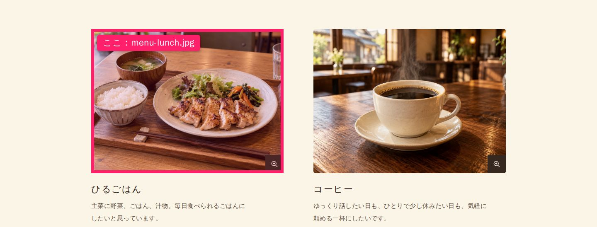 | 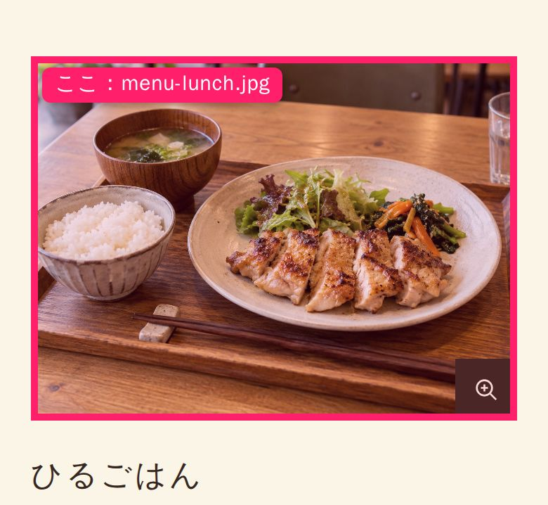 |

**構図ガイド**

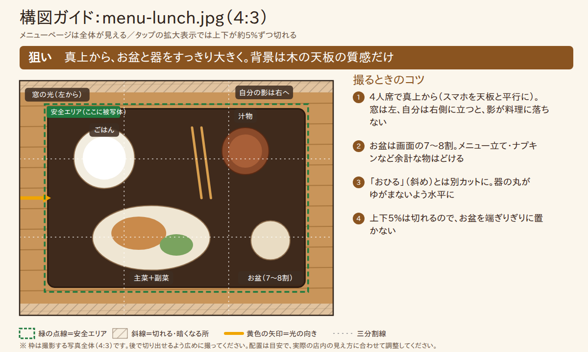

**仮の参考**

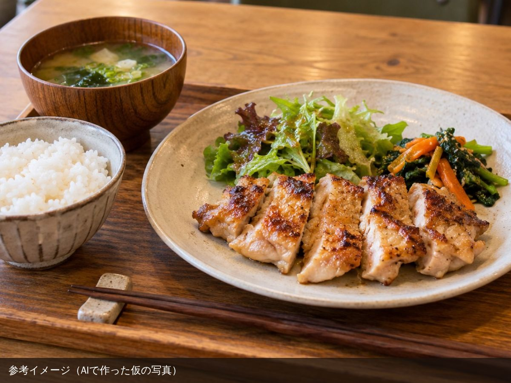

*仮の参考（構図は構図ガイドを優先）。AIで作った仮の写真で、実際のお店とは構図が少し異なります*

**参考画像の生成プロンプト（Codex CLIなど用）**

```text
Top-down overhead flat-lay of a Japanese cafe lunch tray (main dish, side dish, rice, miso soup, chopsticks) on a dark tray over a warm wooden table, camera pointing straight down and parallel to the tabletop. The tray fills 70 to 80 percent of the frame and the bowls look perfectly round. Soft window light from the left, no shadow of the photographer. 4:3 landscape. Photorealistic, natural daylight from the left window, warm white balance, no people's faces, no text, no logos.
```

---

## 6. メニュー：コーヒー（メニューページ）　`menu-coffee.jpg`

| 項目 | 内容 |
|---|---|
| ファイル名 | `menu-coffee.jpg` |
| 比率・サイズ | 4:3・1600×1200 以上 |
| 使う場所 | メニューページ、「コーヒー」の写真 |

**狙い**：カップに寄る。斜め45°上から、琥珀色のカウンターとあたたかい光を背景に

**撮る位置**：間取り図の⑥（カウンターのスツール側の中ほどに立ち、カウンター上のカップへ、右奥に向けて斜め45°上から）

**撮るもの**
- カップの寄り（ヒーロー・ごごとは別カット）。ヒーローは低い位置、これは少し上からの寄り
- 縁・湯気・受け皿が主役。背景は琥珀色のカウンターと棚下の暖色ライト

**構図のコツ**
- カップの縁・湯気・受け皿など、近くで見せたい部分に寄る
- 背景はぼかし、琥珀色のカウンターの質感と暖色のぼけ光を少し見せる
- 光は左の窓から（カメラの左うしろ〜左）。自分の影がカップに落ちない向きに少し体をずらす
- カップは中央でOK。拡大表示で上下が約5%切れるので余白を残す

**NG例**
- ヒーローやごごと同じ写真
- カップが汚れている・指紋が目立つ
- 背景にテレビやバックヤードの扉が写っている

**ページ上の位置**（ピンクの枠が差し替える写真）

| パソコン | スマホ |
|---|---|
| 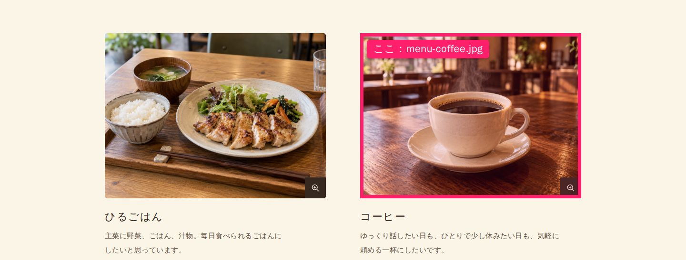 | 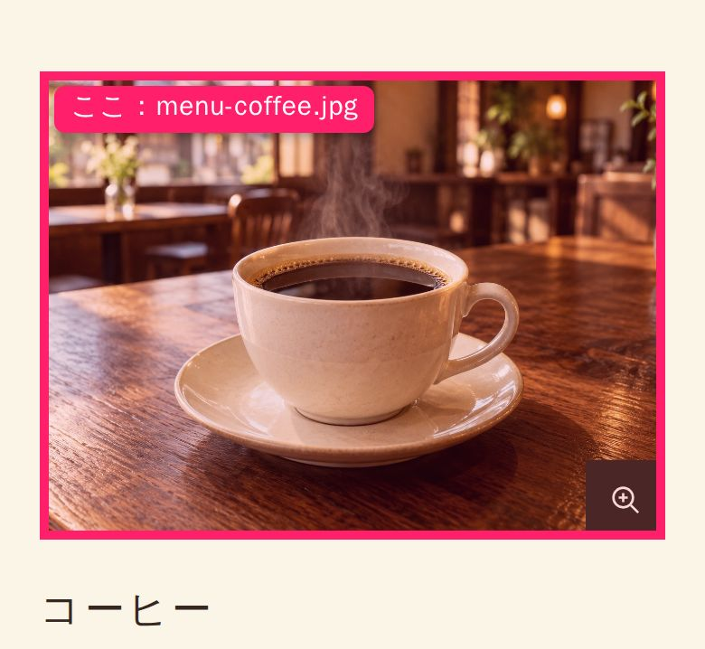 |

**構図ガイド**

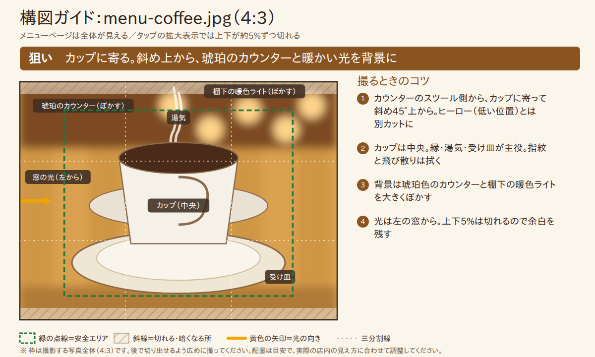

**仮の参考**

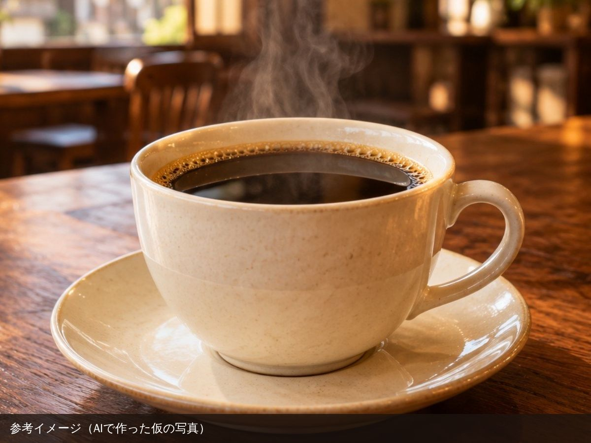

*仮の参考（構図は構図ガイドを優先）。AIで作った仮の写真で、実際のお店とは構図が少し異なります*

**参考画像の生成プロンプト（Codex CLIなど用）**

```text
Tight close-up of a white coffee cup and saucer on a long amber butcher-block cafe counter, shot from about 45 degrees above from the stool side, the cup centered with gentle steam rising. Background strongly blurred: warm amber wood grain of the counter and soft golden under-cabinet light bokeh at the top. Window light from the left, clean cup without fingerprints. 4:3 landscape. Photorealistic, natural daylight from the left window, warm white balance, no people's faces, no text, no logos.
```

---

## 撮影後の渡し方

- `assets/c3/` フォルダに、**上の表のファイル名のとおり**入れてください（または Claude に送ってください）
- 形式は JPEG、長辺は 2000px 以上。重いフィルターや強い加工はかけないでください
- 切り出しや色の調整は、こちらで行います

## チェックリスト

- [ ] `hero.jpg`（最優先）
- [ ] `room.jpg`（最優先）
- [ ] `lunch.jpg`
- [ ] `afternoon.jpg`
- [ ] `menu-lunch.jpg`
- [ ] `menu-coffee.jpg`
